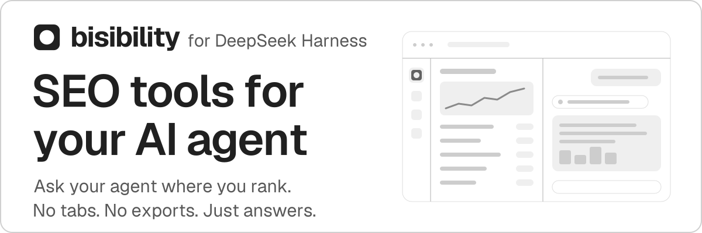

# bisibility for DeepSeek Harness

<p>
  
</p>

[](https://bisibility.com)
[](https://bisibility.com/docs)
[](https://bisibility.com/docs/agents)
[](LICENSE)
[](https://github.com/CorgiCorner/bisibility-dsh-plugin/tags)
[](#install)

> Part of [bisibility](https://github.com/CorgiCorner/bisibility) - an open-source SEO
> platform for keyword research, backlink analysis, and Google rank tracking. This repository
> contains the DeepSeek Harness plugin.

**Ask your agent where you rank. No tabs, no exports, just answers.**

A sidebar panel signs you in to bisibility once with OAuth, and the DeepSeek Harness agent gets
the bisibility MCP tools: rank tracking, keyword research, backlinks, and AI visibility. No API
key to paste, no token in a config file.

## Install

**From the plugin market (recommended, shows updates).** In Plugins, select More beside
Experimental plugins and enable Custom plugin markets. Open Discover, select Add index
source, and enter:

```text
https://corgicorner.github.io/bisibility-dsh-plugin/index.json
```

Select bisibility and confirm the source and commit to install. The index URL goes into
Add index source, not into Add plugin.

**With Add plugin.** Paste this release, pinned to its tag:

```text
git+https://github.com/CorgiCorner/bisibility-dsh-plugin.git#v0.2.2
```

Without a tag, the address installs the latest release:

```text
git+https://github.com/CorgiCorner/bisibility-dsh-plugin.git
```

The same addresses work with the CLI, for example
`dsh plugin add git+https://github.com/CorgiCorner/bisibility-dsh-plugin.git#v0.2.2`.

After installing, quit and reopen DeepSeek Harness, then select Connect account in the
bisibility panel.

## Updates and rollback

The panel and the market show when a newer version is available; the panel reads the
market index at most every six hours. Install the chosen
version from the market card; choose an older version in the Versions list to roll back.
For an Add plugin install, remove the plugin and add the address of the new tag. Release
notes say what each update needs.

After installing or updating, quit and reopen DeepSeek Harness. The desktop app has
no reload shortcut, and the sidebar entry and Host code load at startup. Your
bisibility sign-in survives updates: the OAuth records live in
`~/.dsh/.credentials.yaml`, not in the plugin.

## Troubleshooting

- **No bisibility icon in the sidebar.** Quit and reopen DeepSeek Harness.
- **Startup reports `@bisibility/dsh-plugin: import failed`.** Another copy of the
  plugin is installed, for example an older local install under a different name.
  Remove every bisibility entry on the Plugins page, install it again from the market,
  then quit and reopen the app.
- **The panel asks you to connect again.** Select Connect account. If the browser
  lands on the bisibility dashboard instead of returning to the harness, you are
  signed in; select Connect account once more to finish.
- **Installation is refused for an incompatible version.** The plugin declares the
  DeepSeek Harness versions it supports. Update DeepSeek Harness, or pick a version
  the market marks as compatible.

## How it works

The hosted Bisibility MCP resource (`https://bisibility.com/api/mcp`) is an OAuth
2.1 protected resource, while the shipped MCP client
(`@deepseek-ai/dsh-mcp-client`) only accepts a static `Authorization` header.
This bundle closes that gap without forking the client:

| Piece | Role |
|-|-|
| `index.js` (Host) | OAuth 2.1 authorization-code flow with dynamic client registration and PKCE S256, token storage, loopback MCP proxy, MCP client mount |
| `client.js` (browser) | Left-sidebar entry (`sidebar.panellist`, id `bisibility`), the `main` panel, and the New Bisibility conversation action |
| `cordis.patch.yml` | Declares the panel row and the `bisibility` agent preset; the MCP client row is created at runtime |

1. The panel calls `POST /bisibility/oauth/open`, which registers a public OAuth
   client on first use, builds the PKCE challenge, and opens the authorization
   URL in the default browser. `GET /bisibility/oauth/start` returns the same URL
   without launching anything.
2. `GET /bisibility/oauth/callback` validates `state`, exchanges the code, and
   stores the refresh token in the harness credential store
   (`BISIBILITY_OAUTH_REFRESH_TOKEN`), never in a patch file or the environment.
   A pending sign-in stays valid for 15 minutes, across a Host reload.
3. With a token available, the Host mounts `@deepseek-ai/dsh-mcp-client` against
   the loopback proxy, so the client never starts against an unauthenticated
   endpoint.
4. `POST /bisibility/mcp` forwards to the resource with a fresh Bearer token,
   refreshing it 60 seconds before expiry. Requests carrying a browser `Origin`
   or `Sec-Fetch-Site` header are refused, so a web page cannot drive paid tools
   through the proxy. The other OAuth routes, except the callback, require the
   DeepSeek Harness session and answer 401 without it.
5. Each forwarded request carries `X-Bisibility-Client:
   bisibility-dsh-plugin/<version>`. When Bisibility answers `426` because the
   installed version is below its minimum, the panel shows Update required with
   that minimum and a button to the Plugins page.

If you sign in from a signed-out browser, Bisibility may land on its dashboard
instead of returning to the harness. You are signed in at that point; press
Connect account once more to finish.

The patch also declares an empty agent preset with id `bisibility`. The panel's
primary action starts a new conversation with that preset, so the session log
records it. Scopes requested: `read write offline_access`.

Timeouts: 30 s for client registration and each token request, 10 s for the
account lookup, and 300 s for one MCP tool call. The proxy waits 30 s longer and
answers `504` on its own timeout.

### Compatibility contract

Role ids (`bisibility`, `preset-bisibility`) and route paths
(`/bisibility/oauth/*`, `/bisibility/mcp`) are stable. Overrides in your profile
`cordis.patch.yml` address rows by id, so a change to either is a breaking release.

## Development

- Install a checkout into a development profile as a `link:` dependency, for example
  through the Plugins page with the absolute path of the checkout.
- `client.js`, copy, styles, and locale load in the browser half: reload the page.
  Development builds have Reload Page (Cmd+R); in the packaged app open DevTools with
  F12 and run `location.reload()`, or quit and reopen the app.
- `index.js` and `cordis.patch.yml` load in the Host: remove and add the plugin again,
  or restart the app.
- The client module id in `client.js` and the patch row name must equal the package
  name; `npm run check` enforces both.
- Checks: `npm ci`, `npm run check`, and `node --test`. Against a running Host,
  `node scripts/check.mjs --host http://127.0.0.1:3000` expects 401 from
  `/bisibility/oauth/status`, 200 from an MCP `initialize`, and 403 for a request with
  an `Origin` header.
- Sign-in state lives in `~/.dsh/.credentials.yaml` under `BISIBILITY_OAUTH_*`. Remove
  those entries to test a first sign-in.
